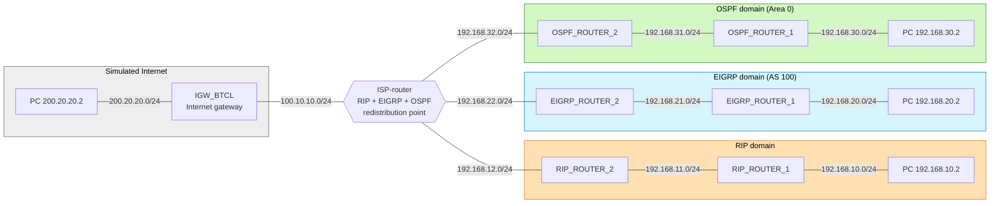

# Route Redistribution Lab: RIP, EIGRP and OSPF Through One ISP Router


Three LAN domains, each running a **different routing protocol** (RIP, EIGRP, OSPF), cannot reach each other until one router that runs all three **redistributes routes between them**. A static default route to a simulated internet gateway is then propagated into every protocol.

> **Scope:** A student lab built in Cisco Packet Tracer. It is not a production design, and I make no claim of enterprise experience. Route redistribution is generally taught beyond the CCNA level, so this lab extends my CCNA practice.

## Contents

[At a glance](#at-a-glance) · [Topology](#topology) · [Addressing](#ip-addressing) · [Design](#design-one-redistribution-point) · [Part 1](#part-1-dynamic--dynamic-redistribution) · [Part 2](#part-2-static--default--dynamic-redistribution) · [Verification](#verification) · [Troubleshooting](#troubleshooting) · [Lessons and skills](#lessons-learned-and-skills) · [Limitations](#limitations-and-next-steps) · [Repository](#repository-and-how-to-open-the-lab)

---

## At a glance

| | |
|---|---|
| **Problem** | Each LAN could reach its own domain, but not LANs in other protocol domains. Routing protocols do not exchange routes with each other on their own. |
| **Part 1 fix** | The ISP router is the only router running RIP, EIGRP and OSPF, so it redistributes between all three (six directions). |
| **Part 2 fix** | A static default route to the internet gateway is propagated with `default-information originate` (RIP, OSPF) and `redistribute static` (EIGRP). |
| **Result** | Every LAN reached every other LAN and the simulated internet (`200.20.20.2`). Routes show as `R`, `O E2` and `D EX`, and every domain holds a default route (`R*`, `O*E2`, `D*EX`). |
| **Scale** | 8 routers, 3 routing domains, 1 redistribution router, 3 default-route mechanisms |

---

## Topology




Hostnames in the captured output differ slightly from the diagram labels: `ISP-router`, `IGW_BTCL`, `RIP_ROUTER_1/2`, `EIGRP-router-1`, `EIGRP-Router-2`, `OSPF-router-1/2`.

## IP addressing

All links are `/24`. DCE = the side providing `clock rate 2000000`. Every address is read from the running-configs in [`configs/`](configs/).

| Router | Interface | IP address | Connects to |
|---|---|---|---|
| **ISP-router** | Se0/0/0 | 100.10.10.2 (DCE) | IGW_BTCL Se0/0/0 |
| | Se0/0/1 | 192.168.12.2 | RIP_ROUTER_2 Se0/0/0 |
| | Se0/1/0 | 192.168.22.2 | EIGRP_ROUTER_2 Se0/0/0 |
| | Se0/1/1 | 192.168.32.2 | OSPF_ROUTER_2 Se0/0/0 |
| **IGW_BTCL** | Gi0/0 | 200.20.20.1 | LAN, PC 200.20.20.2 |
| | Se0/0/0 | 100.10.10.1 | ISP-router Se0/0/0 |
| **RIP_ROUTER_2** | Se0/0/0 / Se0/0/1 | 192.168.12.1 (DCE) / 192.168.11.2 | ISP-router / RIP_ROUTER_1 |
| **RIP_ROUTER_1** | Gi0/0 / Se0/0/1 | 192.168.10.1 / 192.168.11.1 | LAN, PC 192.168.10.2 / RIP_ROUTER_2 |
| **EIGRP_ROUTER_2** | Se0/0/0 / Se0/0/1 | 192.168.22.1 / 192.168.21.2 | ISP-router / EIGRP_ROUTER_1 |
| **EIGRP_ROUTER_1** | Gi0/0 / Se0/0/1 | 192.168.20.1 / 192.168.21.1 | LAN, PC 192.168.20.2 / EIGRP_ROUTER_2 |
| **OSPF_ROUTER_2** | Se0/0/0 / Se0/0/1 | 192.168.32.1 / 192.168.31.2 | ISP-router / OSPF_ROUTER_1 |
| **OSPF_ROUTER_1** | Gi0/0 / Se0/0/1 | 192.168.30.1 / 192.168.31.1 | LAN, PC 192.168.30.2 / OSPF_ROUTER_2 |

---

## Design: one redistribution point

Routing protocols only exchange routes with neighbors running the **same** protocol, so a RIP router knows nothing about what an OSPF router knows. One router must run all the protocols and copy routes from one into another. In OSPF terms that router is an **ASBR** (Autonomous System Boundary Router).

The **ISP router** is that router. It has one interface in each domain and learns each domain's networks natively:

| ISP interface | Domain | Learns natively |
|---|---|---|
| Se0/0/1 | RIP | `192.168.10.0/24`, `192.168.11.0/24` |
| Se0/1/0 | EIGRP | `192.168.20.0/24`, `192.168.21.0/24` |
| Se0/1/1 | OSPF | `192.168.30.0/24`, `192.168.31.0/24` |
| Se0/0/0 | none (static) | `0.0.0.0/0` via `100.10.10.1` |

With a **single** redistribution point there is no routing-loop risk. Two points would need route tags or filters (see [next steps](#limitations-and-next-steps)). The OSPF domain is one area (Area 0), so the ISP sees `192.168.30.0/24` as `O`, not `O IA`.

---

## Part 1: Dynamic → Dynamic redistribution

### Configuration on the ISP router

```
router ospf 1
 redistribute rip subnets
 redistribute eigrp 100 subnets
 network 192.168.32.0 0.0.0.255 area 0
!
router rip
 redistribute eigrp 100 metric 6
 redistribute ospf 1 metric 5
 network 192.168.12.0
!
router eigrp 100
 redistribute rip metric 1544 200 250 10 1500
 redistribute ospf 1 metric 1544 2000 250 10 1500
 network 192.168.22.0
```

Full file: [`configs/ISP-router.cfg`](configs/ISP-router.cfg).

### All six directions

| From → To | Command (ISP router) | Seed metric | Seen on receiving routers as |
|---|---|---|---|
| RIP → OSPF | `redistribute rip subnets` | Default cost 20, type 2 | `O E2 [110/20]` |
| EIGRP → OSPF | `redistribute eigrp 100 subnets` | Default cost 20, type 2 | `O E2 [110/20]` |
| OSPF → RIP | `redistribute ospf 1 metric 5` | Hop count 5 | `R [120/6]` |
| EIGRP → RIP | `redistribute eigrp 100 metric 6` | Hop count 6 | `R [120/7]` |
| RIP → EIGRP | `redistribute rip metric 1544 200 250 10 1500` | Five-part composite | `D EX [170/2681856]` |
| OSPF → EIGRP | `redistribute ospf 1 metric 1544 2000 250 10 1500` | Five-part composite | `D EX [170/2681856]` |

Each protocol needs its own kind of metric:

- **OSPF** assigns a default seed cost of 20 and external type 2. The `subnets` keyword is needed for subnetted networks. It changes nothing here (all classful `/24`s) but is the correct habit.
- **RIP** needs a hop-count seed. Without one, redistributed routes get an infinite metric and are unusable.
- **EIGRP** needs a five-part metric: bandwidth (kbps), delay (tens of microseconds), reliability, load, MTU. The fields came from the router's own `?` prompts ([screenshot 04](docs/images/screenshots/04-eigrp-metric-and-ping-20.2.png)).

### What the routing tables show

**RIP domain** (`RIP_ROUTER_1`): each redistributed route is its seed metric plus one hop.

```
R    192.168.20.0/24 [120/7] via 192.168.11.2, Serial0/0/1    <- EIGRP origin (seed 6, +1)
R    192.168.30.0/24 [120/6] via 192.168.11.2, Serial0/0/1    <- OSPF origin (seed 5, +1)
```

**OSPF domain** (`OSPF_ROUTER_1`, `OSPF-router-2`): external type 2 routes keep cost 20 however far they travel.

```
O E2 192.168.10.0/24 [110/20] via 192.168.31.2, Serial0/0/1
O    192.168.30.0/24 [110/65] via 192.168.31.1, Serial0/0/1    <- native route, for contrast
```

**EIGRP domain** (`EIGRP-Router-2`): external routes carry administrative distance 170, native ones 90.

```
D EX 192.168.10.0/24 [170/2681856] via 192.168.22.2, Serial0/0/0    <- RIP origin
D    192.168.20.0/24 [90/2172416]  via 192.168.21.1, Serial0/0/1    <- native
D EX 192.168.30.0/24 [170/2681856] via 192.168.22.2, Serial0/0/0    <- OSPF origin
```

**On the ISP router**, `show ip ospf database external` lists seven Type-5 LSAs: three RIP networks and three EIGRP networks at metric 20 type 2, plus `0.0.0.0/0` at metric 1 type 2 ([capture 12](verification/captured-outputs/12_ISP-router_show-ip-ospf-database-external.txt)). `show ip protocols` reports "It is an autonomous system boundary router" for OSPF ([capture 13](verification/captured-outputs/13_ISP-router_show-ip-protocols.txt)).

Full tables: [`verification/captured-outputs/`](verification/captured-outputs/). RIP's 15-hop limit matters here: the seed metrics already use part of the budget, and `RIP_ROUTER_1` sees metric 7 for EIGRP routes.

---

## Part 2: Static / default → Dynamic redistribution

Part 2 gives every domain a path to networks that are **not** in any routing protocol: the simulated internet behind `IGW_BTCL`.

### The static default routes

```
! ISP-router
ip route 0.0.0.0 0.0.0.0 100.10.10.1

! IGW_BTCL (return path)
ip route 0.0.0.0 0.0.0.0 100.10.10.2
```

### Propagating it into each protocol

Each protocol needs a different command:

| Protocol | Command on ISP router | Seen on receiving routers as |
|---|---|---|
| RIP | `default-information originate` (under `router rip`) | `R*   0.0.0.0/0 [120/2]` (RIP_ROUTER_1) |
| OSPF | `default-information originate` (under `router ospf 1`) | `O*E2 0.0.0.0/0 [110/1]` (OSPF-router-2) |
| EIGRP | `redistribute static` (under `router eigrp 100`) | `D*EX 0.0.0.0/0 [170/7289856]` (EIGRP-Router-2) |

### Observation: specific routes and the default route together

> Although RIP learns the redistributed EIGRP and OSPF routes individually, reachability would still be maintained through the propagated default route. The redistributed routes are preferred due to longest-prefix-match and provide more specific routing information.

`RIP_ROUTER_1`'s table holds seven specific `R` routes plus the `R*` default ([screenshot 05](docs/images/screenshots/05-rip-router1-default-route.png)). A packet for `192.168.30.2` uses the specific `/24`. A packet for an address with no specific route, such as `200.20.20.2`, falls back to `0.0.0.0/0`.

A ping from the RIP LAN to `200.20.20.2` succeeded with TTL 124, four routers (RIP_ROUTER_1, RIP_ROUTER_2, ISP-router, IGW_BTCL). The return path works because `IGW_BTCL` has its own default back to the ISP router, and the ISP router knows every internal network ([capture 11](verification/captured-outputs/11_IGW_BTCL_show-ip-route.txt)).

---

## Verification

**Before redistribution**, each domain router only knew its own domain. `OSPF-router-2` showed `O 192.168.30.0/24`, two connected networks and "Gateway of last resort is not set". The ISP router learned all three domains natively (`R`, `D`, `O`) but passed nothing between them ([capture 01](verification/captured-outputs/01_before_ISP-router_show-ip-route-by-protocol.txt)).

**Ping results.** TTL 123 means five routers crossed (128 − 5), TTL 124 means four.

| From | To | Result | Evidence |
|---|---|---|---|
| RIP LAN (192.168.10.2) | OSPF LAN (192.168.30.2) | While redistribution was being added: 4 timeouts, then replies | [02](docs/images/screenshots/02-rip-into-ospf-ping-30.2.png) |
| RIP LAN | EIGRP LAN (192.168.20.2) | While redistribution was being added: 5 timeouts, then replies | [04](docs/images/screenshots/04-eigrp-metric-and-ping-20.2.png) |
| RIP LAN | OSPF LAN, EIGRP LAN, internet | Final state: 4/4 each, 0% loss | [06](docs/images/screenshots/06-rip-lan-pings-200.20.20.2-20.2-30.2.png) |
| Internet PC (200.20.20.2) | EIGRP LAN | 4/4, 0% loss. `tracert`: `200.20.20.1`, `100.10.10.2`, `192.168.22.1`, `192.168.21.1`, `192.168.20.2` | [07](docs/images/screenshots/07-internet-pc-ping-and-tracert-to-eigrp-lan.png) |
| EIGRP LAN | internet, RIP LAN, OSPF LAN | 4/4, 4/4, 3/4. The one loss is the first packet, normally dropped while ARP resolves | [08](docs/images/screenshots/08-eigrp-lan-pings-to-other-lans.png) |
| OSPF LAN | internet, RIP LAN, EIGRP LAN | 4/4 each, 0% loss | [09](docs/images/screenshots/09-ospf-lan-pings-to-other-lans.png) |

Other screenshots: [01](docs/images/screenshots/01-isp-routes-per-protocol-before.png) ISP table by protocol before redistribution, [03](docs/images/screenshots/03-ospf-router1-external-type2.png) RIP networks arriving as `O E2`. Commands used are in [`verification/commands.md`](verification/commands.md).

---

## Troubleshooting

| Symptom | Likely cause | Check | Fix |
|---|---|---|---|
| Domain A cannot reach domain B, but the ISP router knows both | Routes not redistributed in one or both directions | `show ip route` on a router in each domain | Add the missing `redistribute` and check both directions |
| Routes missing from RIP | No seed metric, so the metric is infinite | `show run \| section router rip` | Add `metric <hops>` or `default-metric` |
| Routes missing from EIGRP | No five-part metric | `show run \| section router eigrp` | Add the five values or `default-metric` |
| Subnetted networks missing from OSPF | `subnets` keyword missing | `show run \| section router ospf` | Add `subnets` |
| First pings time out, then succeed | Routes still propagating (RIP updates every 30 s) | Repeat the ping | Wait for convergence |
| Default route missing in one domain | Wrong method for that protocol | `show ip route` in that domain | RIP/OSPF: `default-information originate`. EIGRP: `redistribute static` |
| Return traffic fails | Remote router lacks a route back | `show ip route` on both ends | Check the return direction and the gateway's default route |

In this lab the three problems met were: domains unable to reach each other (fixed by redistribution), redistributed routes needing the right metric per protocol, and the default route needing a different command per protocol.

---

## Lessons learned and skills

- Different protocols do not share routes by themselves. A router running all of them must redistribute.
- Each protocol needs its own kind of seed metric: hop count, composite metric, or OSPF cost with type E2.
- Redistributed routes are labelled (`O E2`, `D EX`) and carry a different administrative distance (EIGRP external is 170).
- The default route is a separate job with a different command per protocol.
- Longest-prefix match decides between a specific route and the default route.
- When two domains cannot talk, check both directions. Early timeouts after a change are normal convergence.

**Skills shown:** configuring RIP, EIGRP and OSPF · route redistribution and seed metrics · static and default routing · reading routing tables and route codes · administrative distance and longest-prefix match · troubleshooting inter-domain reachability · documentation with Markdown, Mermaid and Git.

---

## Limitations and next steps

- [ ] **Add a second redistribution point,** demonstrate loops and suboptimal routing, then fix them with route tags and a route map.
- [ ] **Filter what is redistributed** with prefix lists or distribute lists instead of redistributing everything.
- [ ] **Set `version 2` and `no auto-summary` on RIP.** The RIP configs set no version. It works only because every network is a separate classful `/24`.
- [ ] **Give `redistribute static` a seed metric in EIGRP.** The line has none. Packet Tracer accepted it, but real IOS needs an explicit metric or `default-metric`.
- [ ] **EIGRP metrics were left as they are.** Both redistributions display `2681856` on `EIGRP-Router-2`, a deliberate choice to keep the lab simple, not a verified calculation.
- [ ] Compare OSPF E1 and E2, set explicit router IDs, add passive interfaces on PC-facing LANs, add authentication, and harden devices (`enable secret`, SSH instead of `login` on the VTY lines).

---

## Repository and how to open the lab

```
├── lab/            starting and finished Packet Tracer files
├── configs/        running-configs of all 8 routers
├── verification/   commands.md and captured-outputs/ (13 files)
└── docs/           images/ (topology, screenshots), evidence-to-add.md, commit-history.md
```

1. Install [Cisco Packet Tracer](https://www.netacad.com/) (free with a Cisco Networking Academy account).
2. Open `lab/Router_Redistribution_before_configuring.pkt` to start from the unredistributed network and apply the ISP-router commands above, or open `lab/Router_Redistribution_final.pkt` for the finished lab.
3. Run the commands in [`verification/commands.md`](verification/commands.md) from each router's **CLI** tab.

Not included, and not needed to understand the lab: `show ip route` on `EIGRP-router-1`, `OSPF-router-1` and `RIP_ROUTER_2` in the final state. Optional extras are in [`docs/evidence-to-add.md`](docs/evidence-to-add.md).

---

**Author:** [mushfiq11235](https://github.com/mushfiq11235) · Built as hands-on networking practice · Licensed under the [MIT License](LICENSE)
