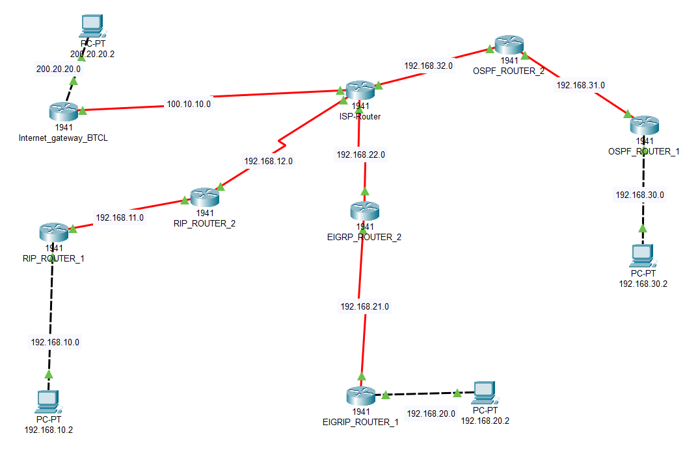
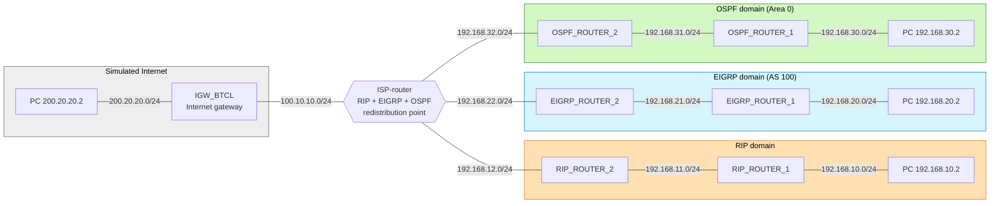

# Route Redistribution Lab: RIP, EIGRP and OSPF Through One ISP Router


A Cisco Packet Tracer lab in which three LAN domains, each running a **different routing protocol** (RIP, EIGRP, OSPF), cannot reach each other until a single router that runs all three protocols (the "ISP router") **redistributes routes between them**. The lab also adds a **static default route** to a simulated internet gateway and propagates it into every protocol.

> **Scope:** This is a student lab built in a simulator. It is not a production design and I make no claim of enterprise experience. Route redistribution is generally taught beyond the CCNA level, so this lab is an extension of my CCNA practice.
---

## Table of Contents

1. [Quick Summary](#1-quick-summary)
2. [Technologies Used](#2-technologies-used)
3. [Network Topology](#3-network-topology)
4. [IP Addressing](#4-ip-addressing)
5. [Design: The ISP Router as the Redistribution Point](#5-design-the-isp-router-as-the-redistribution-point)
6. [Part 1: Dynamic → Dynamic Redistribution](#6-part-1-dynamic--dynamic-redistribution)
7. [Part 2: Static / Default → Dynamic Redistribution](#7-part-2-static--default--dynamic-redistribution)
8. [Verification](#8-verification)
9. [Challenges Encountered and Troubleshooting](#9-challenges-encountered-and-troubleshooting)
10. [Lessons Learned](#10-lessons-learned)
11. [Skills Demonstrated](#11-skills-demonstrated)
12. [Limitations and Future Improvements](#12-limitations-and-future-improvements)
13. [Repository Structure](#13-repository-structure)
14. [How to Open the Lab](#14-how-to-open-the-lab)
15. [Status and Optional Extras](#15-status-and-optional-extras)

---

## 1. Quick Summary

- **Problem:** Each LAN could reach its own domain (and the ISP router's interface in that domain), but LANs in different protocol domains could not reach each other. Routing protocols do not exchange routes with each other on their own.
- **Fix (Part 1):** The ISP router is the only router that runs RIP, EIGRP and OSPF, so it redistributes routes between all three protocols.
- **Fix (Part 2):** A static default route to the internet gateway is propagated into each protocol: `default-information originate` for RIP and OSPF, `redistribute static` for EIGRP.
- **Result:** After redistribution, every LAN reached every other LAN and the simulated internet. For example, a PC in the RIP LAN reached PCs in the OSPF LAN (`192.168.30.2`), the EIGRP LAN (`192.168.20.2`) and the simulated internet (`200.20.20.2`), all 4/4 replies. RIP routers show the other domains as `R` routes, OSPF routers show `O E2`, EIGRP routers show `D EX`, and every domain holds a propagated default route (`R*`, `O*E2`, `D*EX`).

| 3 routing domains | 1 redistribution router | 6 redistribution directions | 3 default-route mechanisms |
|---|---|---|---|

---

## 2. Technologies Used

| Technology | Use in this project |
|---|---|
| Cisco Packet Tracer | Simulation and CLI configuration |
| Cisco 1941 routers (IOS 15.1, per running-config) | All routers |
| RIP | Domain 1 (`192.168.10.0`, `.11.0`, `.12.0`) |
| EIGRP (AS 100) | Domain 2 (`192.168.20.0`, `.21.0`, `.22.0`) |
| OSPF (process 1, Area 0) | Domain 3 (`192.168.30.0`, `.31.0`, `.32.0`) |
| Route redistribution | Exchanging routes between protocols on the ISP router |
| Static default route | Simulated internet access via `Internet_gateway_BTCL` |
| Serial links (DCE clock rate 2000000) | Router interconnects |
| Markdown + Mermaid, Git/GitHub | Documentation |

---

## 3. Network Topology



### Mermaid diagram



### Device name reference

| Diagram label | Hostname in captured output |
|---|---|
| ISP-Router | `ISP-router` |
| Internet_gateway_BTCL | `IGW_BTCL` |
| RIP_ROUTER_1 | `RIP_ROUTER_1` |
| RIP_ROUTER_2 | `RIP_ROUTER_2` |
| EIGRP_ROUTER_1 | `EIGRP-router-1` |
| EIGRP_ROUTER_2 | `EIGRP-Router-2` |
| OSPF_ROUTER_1 | `OSPF-router-1` |
| OSPF_ROUTER_2 | `OSPF-router-2` |

---

## 4. IP Addressing

DCE = side of the serial link providing `clock rate 2000000`.

| Router | Interface | IP address | Connects to | Protocol domain |
|---|---|---|---|---|
| **ISP-router** | Se0/0/0 | 100.10.10.2/24 (DCE) | IGW_BTCL Se0/0/0 | Static default |
| | Se0/0/1 | 192.168.12.2/24 | RIP_ROUTER_2 Se0/0/0 | RIP |
| | Se0/1/0 | 192.168.22.2/24 | EIGRP_ROUTER_2 Se0/0/0 | EIGRP |
| | Se0/1/1 | 192.168.32.2/24 | OSPF_ROUTER_2 Se0/0/0 | OSPF |
| **IGW_BTCL** | Gi0/0 | 200.20.20.1/24 | LAN, PC 200.20.20.2 | Static default |
| | Se0/0/0 | 100.10.10.1/24 | ISP-router Se0/0/0 | |
| **RIP_ROUTER_2** | Se0/0/0 | 192.168.12.1/24 (DCE) | ISP-router Se0/0/1 | RIP |
| | Se0/0/1 | 192.168.11.2/24 | RIP_ROUTER_1 Se0/0/1 | RIP |
| **RIP_ROUTER_1** | Gi0/0 | 192.168.10.1/24 | LAN, PC 192.168.10.2 | RIP |
| | Se0/0/1 | 192.168.11.1/24 | RIP_ROUTER_2 Se0/0/1 | RIP |
| **EIGRP_ROUTER_2** | Se0/0/0 | 192.168.22.1/24 | ISP-router Se0/1/0 | EIGRP |
| | Se0/0/1 | 192.168.21.2/24 | EIGRP_ROUTER_1 | EIGRP |
| **EIGRP_ROUTER_1** | Gi0/0 | 192.168.20.1/24 | LAN, PC 192.168.20.2 | EIGRP |
| | Se0/0/1 | 192.168.21.1/24 | EIGRP_ROUTER_2 Se0/0/1 | EIGRP |
| **OSPF_ROUTER_2** | Se0/0/0 | 192.168.32.1/24 | ISP-router Se0/1/1 | OSPF |
| | Se0/0/1 | 192.168.31.2/24 | OSPF_ROUTER_1 Se0/0/1 | OSPF |
| **OSPF_ROUTER_1** | Gi0/0 | 192.168.30.1/24 | LAN, PC 192.168.30.2 | OSPF |
| | Se0/0/1 | 192.168.31.1/24 | OSPF_ROUTER_2 Se0/0/1 | OSPF |

*Every address above is read from a captured running-config in [`configs/`](configs/).*

---

## 5. Design: The ISP Router as the Redistribution Point

Routing protocols only exchange routes with neighbors running the **same** protocol. A RIP router has no idea what an OSPF router knows. To connect the domains, one router must run **all** the protocols and copy routes from one into another. That router is called an **ASBR** (Autonomous System Boundary Router) in OSPF terms.

In this lab the **ISP router** plays that role. It is the only router with an interface in each domain:

| ISP interface | Domain | Learns natively |
|---|---|---|
| Se0/0/1 | RIP | `192.168.10.0/24`, `192.168.11.0/24` |
| Se0/1/0 | EIGRP | `192.168.20.0/24`, `192.168.21.0/24` |
| Se0/1/1 | OSPF | `192.168.30.0/24`, `192.168.31.0/24` |
| Se0/0/0 | none (static) | `0.0.0.0/0` via `100.10.10.1` |

**Why a single redistribution point?** With one ASBR there is no risk of a routing loop or of routes feeding back into the domain they came from. Using two redistribution points introduces that risk and needs route tags or filters (see [Future Improvements](#12-limitations-and-future-improvements)).

**OSPF domain placement:** the ISP router learns `192.168.30.0/24` as `O` (not `O IA`), which indicates the OSPF domain is a single area (Area 0, as in the ISP's `network ... area 0` statement).

---

## 6. Part 1: Dynamic → Dynamic Redistribution

### 6.1 What was configured on the ISP router

```
router ospf 1
 redistribute rip subnets
 redistribute eigrp 100 subnets
 network 192.168.32.0 0.0.0.255 area 0
!
router rip
 redistribute eigrp 100 metric 6
 redistribute ospf 1 metric 5
 network 192.168.12.0
!
router eigrp 100
 redistribute rip metric 1544 200 250 10 1500
 redistribute ospf 1 metric 1544 2000 250 10 1500
 network 192.168.22.0
```

Full file: [`configs/ISP-router.cfg`](configs/ISP-router.cfg).

### 6.2 All six directions

| From → To | Command (on ISP router) | How the metric is set | How it appears on the receiving routers |
|---|---|---|---|
| RIP → OSPF | `redistribute rip subnets` | Default seed cost 20, external type 2 | `O E2 ... [110/20]` |
| EIGRP → OSPF | `redistribute eigrp 100 subnets` | Default seed cost 20, external type 2 | `O E2 ... [110/20]` (captured on OSPF-router-2) |
| OSPF → RIP | `redistribute ospf 1 metric 5` | Hop-count seed of 5 | `R ... [120/6]` |
| EIGRP → RIP | `redistribute eigrp 100 metric 6` | Hop-count seed of 6 | `R ... [120/7]` |
| RIP → EIGRP | `redistribute rip metric 1544 200 250 10 1500` | Five-part composite metric | `D EX ... [170/2681856]` |
| OSPF → EIGRP | `redistribute ospf 1 metric 1544 2000 250 10 1500` | Five-part composite metric | `D EX ... [170/2681856]` |

### 6.3 Why each protocol handles the metric differently

| Protocol | What redistribution needs | What this lab used |
|---|---|---|
| **OSPF** | A default seed cost of 20 and external type 2 (E2). The `subnets` keyword is needed to redistribute subnetted networks. | `subnets` added. All networks here are classful `/24` Class C networks, so it would not change this result, but it is the correct habit. |
| **RIP** | A hop-count seed metric. Without one, redistributed routes get an infinite metric and are not usable. | 5 (from OSPF) and 6 (from EIGRP) |
| **EIGRP** | A five-part metric: bandwidth (kbps), delay (tens of microseconds), reliability, load, MTU. | Bandwidth 1544, reliability 250, load 10, MTU 1500. Delay 200 for RIP routes and 2000 for OSPF routes. |

The five EIGRP metric fields come from the router's own prompts, shown in [`docs/images/screenshots/04-eigrp-metric-and-ping-20.2.png`](docs/images/screenshots/04-eigrp-metric-and-ping-20.2.png).

### 6.4 What the routing tables show

**RIP domain sees OSPF and EIGRP routes as individual RIP routes.** Seed metric + 1 hop is what `RIP_ROUTER_1` shows:

```
R    192.168.12.0/24 [120/1] via 192.168.11.2, Serial0/0/1
R    192.168.20.0/24 [120/7] via 192.168.11.2, Serial0/0/1    <- EIGRP origin (seed 6, +1)
R    192.168.21.0/24 [120/7] via 192.168.11.2, Serial0/0/1
R    192.168.22.0/24 [120/7] via 192.168.11.2, Serial0/0/1
R    192.168.30.0/24 [120/6] via 192.168.11.2, Serial0/0/1    <- OSPF origin (seed 5, +1)
R    192.168.31.0/24 [120/6] via 192.168.11.2, Serial0/0/1
R    192.168.32.0/24 [120/6] via 192.168.11.2, Serial0/0/1
```

**OSPF domain sees RIP networks as OSPF external type 2** (`OSPF_ROUTER_1`, captured after RIP was redistributed into OSPF):

```
O E2 192.168.10.0/24 [110/20] via 192.168.31.2, Serial0/0/1
O E2 192.168.11.0/24 [110/20] via 192.168.31.2, Serial0/0/1
O E2 192.168.12.0/24 [110/20] via 192.168.31.2, Serial0/0/1
```

All three show the same cost of 20: an `E2` route keeps its external seed cost no matter how far it travels inside OSPF.

**OSPF_ROUTER_2** shows the EIGRP networks the same way (`O E2 [110/20]` for `192.168.20.0`, `.21.0`, `.22.0`), while its own domain's `192.168.30.0/24` stays a plain `O [110/65]`. See [`10_after_OSPF-router-2...`](verification/captured-outputs/10_after_OSPF-router-2_show-ip-route_redistribution-and-default.txt).

**EIGRP domain sees RIP and OSPF networks as EIGRP external** (`EIGRP-Router-2`), with administrative distance 170 instead of the internal 90:

```
D EX 192.168.10.0/24 [170/2681856] via 192.168.22.2, Serial0/0/0    <- RIP origin
D EX 192.168.11.0/24 [170/2681856] via 192.168.22.2, Serial0/0/0
D EX 192.168.12.0/24 [170/2681856] via 192.168.22.2, Serial0/0/0
D    192.168.20.0/24 [90/2172416]  via 192.168.21.1, Serial0/0/1    <- native EIGRP, AD 90
D EX 192.168.30.0/24 [170/2681856] via 192.168.22.2, Serial0/0/0    <- OSPF origin
D EX 192.168.31.0/24 [170/2681856] via 192.168.22.2, Serial0/0/0
D EX 192.168.32.0/24 [170/2681856] via 192.168.22.2, Serial0/0/0
```

Full file: [`09_after_EIGRP-Router-2...`](verification/captured-outputs/09_after_EIGRP-Router-2_show-ip-route_redistribution-and-default.txt).

**On the ISP router itself**, `show ip ospf database external` lists seven Type-5 external LSAs: the three RIP networks and three EIGRP networks at metric 20 type 2, plus `0.0.0.0/0` at metric 1 type 2 ([`12_...`](verification/captured-outputs/12_ISP-router_show-ip-ospf-database-external.txt)). `show ip protocols` confirms the redistribution and reports "It is an autonomous system boundary router" for OSPF ([`13_...`](verification/captured-outputs/13_ISP-router_show-ip-protocols.txt)).

Full outputs, including the **before** tables, are in [`verification/captured-outputs/`](verification/captured-outputs/).

### 6.5 Observations

- **Only the redistribution point has all the routes natively.** The ISP's own table shows `R`, `D` and `O` routes (see [`08_after_ISP-router_show-ip-route_final.txt`](verification/captured-outputs/08_after_ISP-router_show-ip-route_final.txt)). The other routers receive the redistributed routes.
- **RIP's 15-hop limit matters.** Seed metrics of 5 and 6 plus RIP hops use up part of the budget. `RIP_ROUTER_1` already sees metric 7 for EIGRP routes.
- **Redistribution is not instant.** The first pings after configuring it timed out before replies started (see [section 8](#8-verification)).

---

## 7. Part 2: Static / Default → Dynamic Redistribution

Part 2 gives every domain a way to reach networks that are **not** in any routing protocol, here the simulated internet (`200.20.20.0/24` behind `Internet_gateway_BTCL`).

### 7.1 The static default route

```
! ISP-router
ip route 0.0.0.0 0.0.0.0 100.10.10.1

! IGW_BTCL (return path)
ip route 0.0.0.0 0.0.0.0 100.10.10.2
```

The ISP's table then shows:

```
Gateway of last resort is 100.10.10.1 to network 0.0.0.0
S*   0.0.0.0/0 [1/0] via 100.10.10.1
```

### 7.2 Propagating it into each protocol

| Protocol | Command on ISP router | Appears on receiving routers as |
|---|---|---|
| RIP | `default-information originate` (under `router rip`) | `R*   0.0.0.0/0` (captured on RIP_ROUTER_1) |
| OSPF | `default-information originate` (under `router ospf 1`) | `O*E2 0.0.0.0/0 [110/1]` (captured on OSPF-router-2) |
| EIGRP | `redistribute static` (under `router eigrp 100`) | `D*EX 0.0.0.0/0 [170/7289856]` (captured on EIGRP-Router-2) |

Each protocol needs a different command. RIP and OSPF have a dedicated default-originate command, while EIGRP carries the static default route through `redistribute static`.

Captured proof for OSPF and EIGRP:

```
OSPF-router-2#sh ip route
Gateway of last resort is 192.168.32.2 to network 0.0.0.0
O*E2 0.0.0.0/0 [110/1] via 192.168.32.2, Serial0/0/0

EIGRP-Router-2#sh ip route
Gateway of last resort is 192.168.22.2 to network 0.0.0.0
D*EX 0.0.0.0/0 [170/7289856] via 192.168.22.2, Serial0/0/0
```

Captured proof for RIP:

```
RIP_ROUTER_1#sh ip route
Gateway of last resort is 192.168.11.2 to network 0.0.0.0
...
R*   0.0.0.0/0 [120/2] via 192.168.11.2, 00:00:11, Serial0/0/1
```

### 7.3 Observation: specific routes and the default route together

Although RIP learns the redistributed EIGRP and OSPF routes individually, reachability would still be maintained through the propagated default route. The redistributed routes are preferred because of **longest-prefix match**, so they provide more specific routing information than `0.0.0.0/0`.

You can see both in `RIP_ROUTER_1`'s table above: seven specific `R` routes plus the `R*` default. A packet for `192.168.30.2` uses the specific `/24`, while a packet for an address with no specific route (for example `200.20.20.2`) falls back to `0.0.0.0/0`.

The default route is what gives the internal LANs a path to networks that are not redistributed, such as `200.20.20.0/24` and `100.10.10.0/24`. A ping from the RIP LAN (`192.168.10.2`) to `200.20.20.2` succeeded with 4/4 replies and TTL 124, which is four routers (RIP_ROUTER_1, RIP_ROUTER_2, ISP-router, IGW_BTCL). The return path works because `IGW_BTCL` has its own static default back to the ISP router, and the ISP router knows every internal network. See [`11_IGW_BTCL_show-ip-route.txt`](verification/captured-outputs/11_IGW_BTCL_show-ip-route.txt).

---

## 8. Verification

### 8.1 Before redistribution

Each domain router only knows its own domain. Example, `OSPF-router-2` before redistribution:

```
O    192.168.30.0/24 [110/65] via 192.168.31.1, Serial0/0/1
C    192.168.31.0/24 is directly connected, Serial0/0/1
C    192.168.32.0/24 is directly connected, Serial0/0/0
Gateway of last resort is not set
```

The ISP router learned all three domains through their native protocols (`R`, `D`, `O`), but still did not pass routes between them. See [`01_before_ISP-router_show-ip-route-by-protocol.txt`](verification/captured-outputs/01_before_ISP-router_show-ip-route-by-protocol.txt).

### 8.2 Ping results

TTL 123 means the packet crossed five routers (128 − 5).

| From | To | Result | Evidence |
|---|---|---|---|
| 192.168.10.2 (RIP LAN) | 192.168.30.2 (OSPF LAN) | While redistribution was being added: 4 timeouts, then replies, TTL 123 | [`02-rip-into-ospf-ping-30.2.png`](docs/images/screenshots/02-rip-into-ospf-ping-30.2.png) |
| 192.168.10.2 (RIP LAN) | 192.168.20.2 (EIGRP LAN) | While redistribution was being added: 5 timeouts, then replies, TTL 123 | [`04-eigrp-metric-and-ping-20.2.png`](docs/images/screenshots/04-eigrp-metric-and-ping-20.2.png) |
| 192.168.10.2 (RIP LAN) | 192.168.30.2, 192.168.20.2, 200.20.20.2 | Final state: 4/4 replies each, 0% loss, TTL 123 / 123 / 124 | [`06-rip-lan-pings-...png`](docs/images/screenshots/06-rip-lan-pings-200.20.20.2-20.2-30.2.png) |
| 200.20.20.2 (internet PC) | 192.168.20.2 (EIGRP LAN) | 4/4 replies, 0% loss, TTL 124. The return path works. `tracert` shows `200.20.20.1`, `100.10.10.2`, `192.168.22.1`, `192.168.21.1`, `192.168.20.2` | [`07-internet-pc-ping-and-tracert-to-eigrp-lan.png`](docs/images/screenshots/07-internet-pc-ping-and-tracert-to-eigrp-lan.png) |
| 192.168.20.2 (EIGRP LAN) | 200.20.20.2, 192.168.10.2, 192.168.30.2 | Final state: 4/4 (TTL 124), 4/4 (TTL 123), 3/4 (TTL 123). The one loss is the first packet to `192.168.30.2`, normally lost while ARP resolves | [`08-eigrp-lan-pings-to-other-lans.png`](docs/images/screenshots/08-eigrp-lan-pings-to-other-lans.png) |
| 192.168.30.2 (OSPF LAN) | 200.20.20.2, 192.168.10.2, 192.168.20.2 | Final state: 4/4 each, 0% loss, TTL 124 / 123 / 123 | [`09-ospf-lan-pings-to-other-lans.png`](docs/images/screenshots/09-ospf-lan-pings-to-other-lans.png) |

### 8.3 Screenshots

| Screenshot | Shows |
|---|---|
| [`01`](docs/images/screenshots/01-isp-routes-per-protocol-before.png) | ISP table by protocol (`R`, `D`, `O`) before redistribution |
| [`02`](docs/images/screenshots/02-rip-into-ospf-ping-30.2.png) | `redistribute rip subnets` on the ISP, and the ping from the RIP LAN to the OSPF LAN |
| [`03`](docs/images/screenshots/03-ospf-router1-external-type2.png) | RIP networks arriving on `OSPF-router-1` as `O E2` |
| [`04`](docs/images/screenshots/04-eigrp-metric-and-ping-20.2.png) | EIGRP redistribution metric prompts, and the ping to the EIGRP LAN |
| [`05`](docs/images/screenshots/05-rip-router1-default-route.png) | `RIP_ROUTER_1` with specific `R` routes and the `R*` default |
| [`06`](docs/images/screenshots/06-rip-lan-pings-200.20.20.2-20.2-30.2.png) | Final-state pings from the RIP LAN to the internet, EIGRP LAN and OSPF LAN |
| [`07`](docs/images/screenshots/07-internet-pc-ping-and-tracert-to-eigrp-lan.png) | Internet PC pinging and tracing the route to the EIGRP LAN (return path) |
| [`08`](docs/images/screenshots/08-eigrp-lan-pings-to-other-lans.png) | EIGRP LAN pinging the internet, RIP LAN and OSPF LAN |
| [`09`](docs/images/screenshots/09-ospf-lan-pings-to-other-lans.png) | OSPF LAN pinging the internet, RIP LAN and EIGRP LAN |

### 8.4 Commands used

See [`verification/commands.md`](verification/commands.md).

---

## 9. Challenges Encountered and Troubleshooting

### Issue 1: Domains could not reach each other

**Problem:** Each LAN could ping within its own domain, and the ISP router's table contained routes from all three protocols, but LANs in different domains could not reach each other.

**Cause:** Routing protocols only exchange routes with neighbors running the same protocol. The ISP router had learned all three domains but was not sharing routes between them.

**Resolution:** Redistribution on the ISP router, the only router running all three protocols. After RIP and OSPF were redistributed into each other, pings between the RIP LAN and the OSPF LAN succeeded (after a short delay). The same worked for EIGRP.

### Issue 2: Redistributed routes need the right metric for each protocol

**Problem:** RIP and EIGRP do not know how to value routes that come from another protocol.

**Resolution:** Explicit seed metrics: hop counts for RIP, and the five-part composite metric for EIGRP (explored through the router's `?` prompts). OSPF uses a default seed cost with type E2.

### Issue 3: Default route needs a different method per protocol

**Problem:** One static default on the ISP router did not automatically reach the RIP, OSPF and EIGRP domains.

**Resolution:** `default-information originate` under RIP and OSPF, and `redistribute static` under EIGRP.

### Symptom table

| Symptom | Likely cause | Check | Fix |
|---|---|---|---|
| Domain A cannot reach domain B, but the redistribution router knows both | Routes not redistributed in one or both directions | `show ip route` on a router in each domain | Add the missing `redistribute` command, then check both directions |
| Redistributed routes missing from RIP | No seed metric, so the metric is infinite | `show run \| section router rip` | Add `metric <hops>` to `redistribute`, or set `default-metric` |
| Redistributed routes missing from EIGRP | No five-part metric | `show run \| section router eigrp` | Add the five metric values, or set `default-metric` |
| Subnetted networks missing from OSPF | `subnets` keyword missing | `show run \| section router ospf` | Add `subnets` |
| First pings time out, then succeed | Routes still propagating (RIP updates every 30 s) | Repeat the ping | Wait for convergence |
| Default route missing in one domain | Wrong default-route method for that protocol | `show ip route` on a router in that domain | OSPF/RIP: `default-information originate`. EIGRP: `redistribute static`. |
| Return traffic fails | Remote router lacks a route back | `show ip route` on both ends | Check redistribution in the return direction, and default routes on the gateway |

---

## 10. Lessons Learned

- **Different protocols do not share routes by themselves.** A router that runs all of them must redistribute.
- **Each protocol needs its own metric.** The concept (a seed metric) is the same, but the form is different for RIP, EIGRP and OSPF.
- **Redistributed routes are labelled.** `O E2`, `R` and `D EX` all show that a route came from another source.
- **The default route is a separate job.** It is propagated with a different command in each protocol.
- **Longest-prefix match decides between a specific route and the default route.**
- **Check both directions** when two domains cannot reach each other.
- **Convergence takes time.** Early timeouts are expected right after changing routing.

---

## 11. Skills Demonstrated

| Skill | Where it appears |
|---|---|
| Configuring RIP, EIGRP and OSPF | Sections 4, 5 |
| Route redistribution between protocols | Section 6 |
| Seed metrics (hop count, composite, OSPF cost) | Section 6.3 |
| Route types (`R`, `D`, `O`, `O E2`, `R*`) | Sections 6.4, 7.2 |
| Static and default routing | Section 7 |
| Longest-prefix match and administrative distance | Section 7.3 |
| Reading routing tables and IOS metric prompts | Sections 6, 8 |
| Troubleshooting inter-domain reachability | Section 9 |
| Documentation, diagrams, Git/GitHub | Whole repository |

---

## 12. Limitations and Future Improvements

- [ ] **Add a second redistribution point** and demonstrate the loop and suboptimal-routing problems, then fix them with route tags and a route map.
- [ ] **Filter what is redistributed** with prefix lists or distribute lists, instead of redistributing everything.
- [ ] **Set `version 2` and `no auto-summary` on RIP.** The captured RIP config does not set a version. It works here because every network is a separate classful `/24` (Class C) network, but it would break with subnetted addressing.
- [ ] **EIGRP metrics were left as they are.** Both redistributions display the same metric (`2681856`) on `EIGRP-Router-2`. This was a deliberate choice to keep the lab simple, not a verified calculation.
- [ ] **Give `redistribute static` a seed metric in EIGRP.** The config has no metric on that line. Packet Tracer accepted it (`D*EX [170/7289856]`), but on real IOS EIGRP needs an explicit metric or `default-metric` for redistributed routes to be advertised.
- [ ] **Compare E1 and E2** OSPF external types.
- [ ] **Set explicit router IDs** on all routers.
- [ ] **Add passive interfaces** on PC-facing LANs.
- [ ] **Add authentication** for each protocol.
- [ ] **Basic device hardening:** passwords, `enable secret`, SSH instead of `login` on the VTY lines.

---

## 13. Repository Structure

```
router-redistribution-lab/
├── README.md
├── LICENSE
├── .gitignore
├── lab/
│   └── README.md                 (starting .pkt file)
├── configs/                      (all 8 routers)
│   ├── ISP-router.cfg
│   ├── IGW_BTCL.cfg
│   ├── RIP_ROUTER_1.cfg
│   ├── RIP_ROUTER_2.cfg
│   ├── EIGRP_ROUTER_1.cfg
│   ├── EIGRP_ROUTER_2.cfg
│   ├── OSPF_ROUTER_1.cfg
│   └── OSPF_ROUTER_2.cfg
├── verification/
│   ├── commands.md
│   └── captured-outputs/
│       ├── 01_before_ISP-router_show-ip-route-by-protocol.txt
│       ├── 02_before_RIP_ROUTER_2_show-ip-route.txt
│       ├── 03_before_EIGRP-Router-2_show-ip-route.txt
│       ├── 04_before_OSPF-router-2_show-ip-route.txt
│       ├── 05_after_OSPF-router-1_show-ip-route_RIP-into-OSPF.txt
│       ├── 06_after_RIP_ROUTER_1_show-ip-route_redistribution-and-default.txt
│       ├── 07_ping-results_summary.txt
│       ├── 08_after_ISP-router_show-ip-route_final.txt
│       ├── 09_after_EIGRP-Router-2_show-ip-route_redistribution-and-default.txt
│       ├── 10_after_OSPF-router-2_show-ip-route_redistribution-and-default.txt
│       ├── 11_IGW_BTCL_show-ip-route.txt
│       ├── 12_ISP-router_show-ip-ospf-database-external.txt
│       └── 13_ISP-router_show-ip-protocols.txt
└── docs/
    ├── images/
    │   ├── topology.png
    │   └── screenshots/
    ├── evidence-to-add.md
    ├── portfolio-description.md
    └── commit-history.md
```

---

## 14. How to Open the Lab

1. Install [Cisco Packet Tracer](https://www.netacad.com/) (free with a Cisco Networking Academy account).
2. Open `lab/Router_Redistribution_before_configuring.pkt` (the starting state), then apply the ISP-router commands from section 6.1 and 7.
3. Click a router, open the **CLI** tab, and run the commands in [`verification/commands.md`](verification/commands.md).

---

## 15. Status and Optional Extras

This repository documents the lab from captured configs, routing tables and screenshots. Not included, and not needed to understand the lab:

- `show ip route` on `EIGRP-router-1`, `OSPF-router-1` and `RIP_ROUTER_2` in the final state.
- A finished `.pkt` file (the starting file is in `lab/`).

The optional extras are in [`docs/evidence-to-add.md`](docs/evidence-to-add.md).

---

**Author:** [mushfiq11235](https://github.com/mushfiq11235) · Built as hands-on networking practice · Licensed under the [MIT License](LICENSE)
